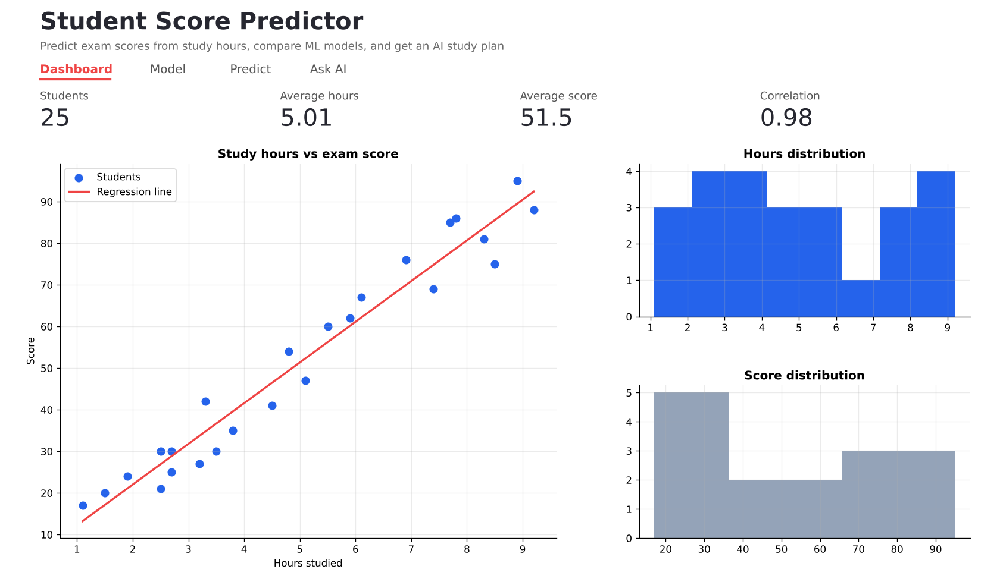
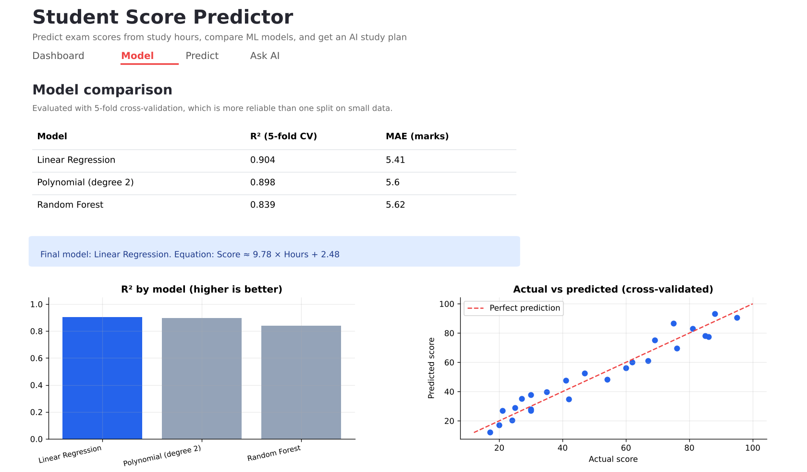
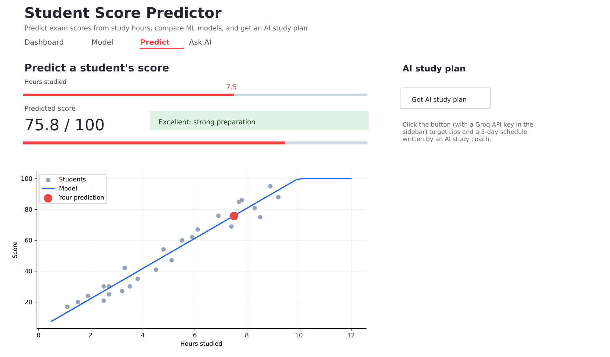

# 🎓 Student Score Predictor

A complete machine learning project that predicts a student's exam score from the number of hours they studied, compares three regression models, and uses the Groq API to generate an AI study plan.

> Built for **Module 06: Final AI & ML Project**

---

## 🎯 Problem Statement

Can we estimate a student's exam score from how many hours they studied, and how reliable is that estimate?

## ✨ Features

- 📊 **Dashboard**: summary metrics, a scatter plot with the regression line, and score and hours distributions
- 🧠 **Model comparison**: Linear Regression vs Polynomial Regression vs Random Forest, evaluated with 5-fold cross-validation
- 🎯 **Score predictor**: choose the hours studied and get a predicted score, with a warning when the input is outside the range the data covers
- 🤖 **AI study plan**: the Groq API (Llama 3.3) writes personalised study tips and a 5-day schedule for the predicted score
- 💬 **AI Chat**: chat with a built-in assistant about the data, predictions and study advice. Built-in answers work with no key; open-ended answers use Groq
- 🎤 **Voice chat**: speak your question (Groq Whisper speech-to-text) and have the answer read aloud (browser text-to-speech)

## 🛠 Tech Stack

Python · Pandas · NumPy · Matplotlib · Scikit-learn · Streamlit · Groq API (Llama 3.3 + Whisper) · Web Speech API

## 📸 Screenshots

| Dashboard | Model comparison |
|---|---|
|  |  |

| Score predictor |
|---|
|  |

## 📂 Dataset

`data/student_scores.csv`: 25 students, 2 columns.

| Column | Meaning |
|---|---|
| Hours | Hours the student studied |
| Scores | Exam score (out of 100) |

There are no missing values. The two columns are strongly related (correlation ≈ 0.98).

## 🔬 Method

1. Load and clean the data (remove duplicates and missing values)
2. Explore the relationship between hours and scores
3. Compare three models using **5-fold cross-validation**, which is more reliable than a single split on only 25 rows
4. Choose **Linear Regression** as the final model: it is the most accurate here, simple, and easy to explain
5. Use the final model to power the predictor, the AI study plan and the chat assistant

## 📊 Results

| Model | R² (5-fold CV) | MAE (marks) |
|---|---|---|
| **Linear Regression** | **0.904** | **5.41** |
| Polynomial (degree 2) | 0.898 | 5.60 |
| Random Forest | 0.839 | 5.62 |

**Final equation:** `Score ≈ 9.78 × Hours + 2.48`

In plain words: each extra hour of study adds about 10 marks, and predictions are off by about 5 marks on average.

## ⚠️ Limitations

- Only 25 students, so results are indicative, not definitive
- Only study hours are used. Real scores also depend on sleep, prior knowledge, teaching quality and more
- Predictions outside 1.1–9.2 hours are extrapolations and less reliable
- AI study plans are general advice, not guarantees

## 🚀 How to Run

1. Download or clone this repository:
   ```bash
   git clone https://github.com/rudrakshsivam/student-score-predictor.git
   cd student-score-predictor
   ```
2. Install the requirements:
   ```bash
   python -m pip install -r requirements.txt
   ```
3. Start the app:
   ```bash
   python -m streamlit run app.py
   ```
4. *(Optional)* For the AI features, get a free key from [console.groq.com](https://console.groq.com). Either paste it into the sidebar box, or save it once on your computer in `~/.streamlit/secrets.toml` as `GROQ_API_KEY = "your_key"` so the app loads it automatically. The dashboard, model comparison, predictor and the chat's built-in answers work without it. Voice input needs the key; use Chrome or Edge and allow microphone access. **Never upload your API key to GitHub.**

## 💡 What I Learned

- Comparing models fairly with cross-validation on a small dataset
- Why simple models can beat complex ones
- Building an interactive app with Streamlit
- Connecting a large language model (Groq) to a machine learning app
- Adding voice input and spoken answers to a web app
- Being honest about what a model can and cannot do

## 🔗 Related Project

- Module 05: Cars Assistant, a price predictor built on my Cars EDA project

## 👤 Author

**Rudraksh Sivam K U** · 25IT301
